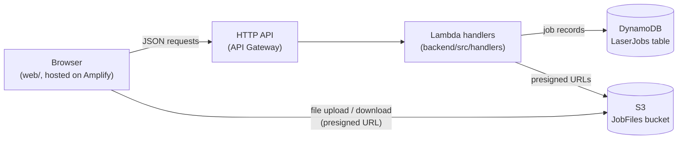
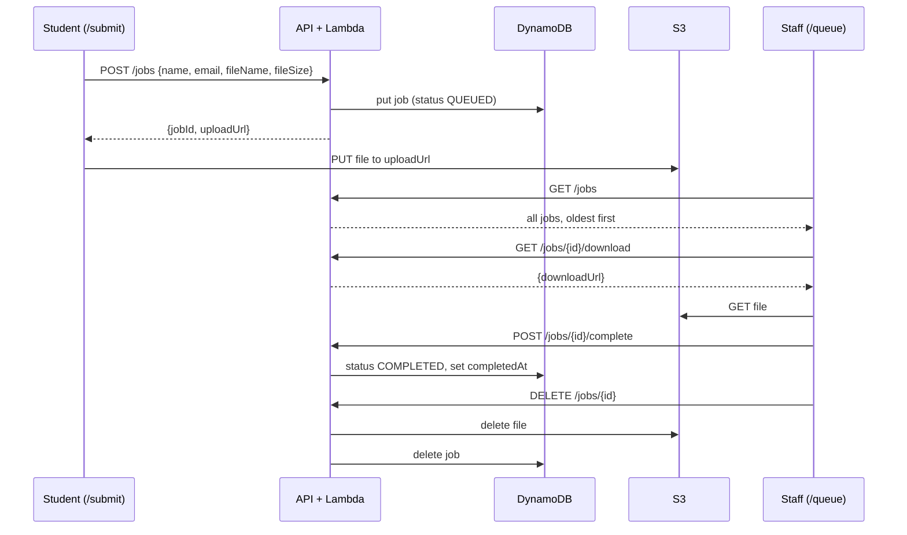

# Architecture

How the pieces fit together, and why they are built this way. For setup and
commands, see the [README](../README.md). For how to make changes, see
[CONTRIBUTING](../CONTRIBUTING.md).

## Overview

There are two pages:

- **`/submit`** (`web/src/pages/SubmitPage.tsx`): students enter their name and
  email and upload an `.ai` file.
- **`/queue`** (`web/src/pages/QueuePage.tsx`): staff on the lab PC see every
  job, download files, mark jobs completed, and delete completed jobs.

All AWS resources are defined in one CDK stack,
`infra/lib/laser-queue-stack.ts`. It is deployed twice, as `LaserQueue-dev` and
`LaserQueue-prod`.

## Job lifecycle

A job is either `QUEUED` or `COMPLETED`. Only completed jobs can be deleted,
and deleting removes both the record and the file.

## Data model

The job record is defined in [`backend/src/types.ts`](../backend/src/types.ts).
That file is the source of truth for its fields.

- **DynamoDB**: one table, partition key `jobId` (a UUID), no secondary
  indexes.
- **S3**: one private bucket. Each file is stored at
  `jobs/{jobId}/{sanitized file name}`.
- **API responses** use `JobSummary`, which is the job without `s3Key`. Bucket
  paths never leave the backend.

`web/src/api.ts` keeps its own copy of these types, because the frontend
doesn't import from `backend/`. If you change one, change the other.

## Design decisions

**Files never pass through Lambda.** Lambda and API Gateway have small payload
limits, and streaming large files through them costs money for no benefit. The
API hands out presigned S3 URLs that expire after a few minutes
(`URL_EXPIRY_SECONDS` in the stack), and the browser talks to S3 directly.

**The file-size limit is enforced by S3, not by the frontend.** `createJob`
signs the upload URL with the exact `Content-Length` the client declared, so S3
rejects an upload of any other size. The frontend also checks the size, but
only to show a friendlier error.

**The job record is written before the file is uploaded.** If a student closes
the tab mid-upload, a `QUEUED` job with no file is left behind. `getDownloadUrl`
checks for the file first and returns a clear 404 when it's missing.

**Delete removes the file first, then the record.** If the S3 delete fails, the
record is still there and staff can retry. Doing it the other way round could
leave files in S3 that nothing points to.

**`GET /jobs` scans the whole table.** That's fine at lab scale (hundreds of
jobs). If the table ever grows large, add a secondary index on `status` or
`createdAt` and query that instead.

**Each Lambda gets only the permissions it needs.** See the `grant*` calls in
the stack: for example, `listJobs` can only read the table.

**Configuration comes from environment variables.** The stack sets
`TABLE_NAME`, `BUCKET_NAME`, `MAX_FILE_SIZE_BYTES` and `URL_EXPIRY_SECONDS` on
every Lambda, and `backend/src/lib/config.ts` reads them. Nothing in
`backend/` hard-codes resource names.

**Local development uses the real dev stack.** There's no local AWS emulator.
`npm run dev` runs the frontend against the deployed `LaserQueue-dev` API, and
`npm run reset:dev` empties it. The reset script refuses to touch any stack
other than dev.

**Prod is protected against accidental deletion.** The prod stack has
termination protection, and its table has deletion protection and
point-in-time recovery. Dev has neither, so it can be torn down freely.

## Known limitations

- **No authentication.** Anyone with the URL can view, complete and delete
  jobs, including on `/queue`. This is the biggest gap to close before wider
  use.
- **CORS allows any origin** (`ALLOWED_ORIGINS` in the stack). There's a TODO
  to restrict it to the Amplify URL.
- **No automated tests for the app itself.** CI type-checks every workspace,
  builds the frontend and synthesizes the CDK stack. Only `scripts/deploy.mjs`
  has tests.
- **The queue page doesn't update on its own.** Staff press Refresh to see new
  submissions.
