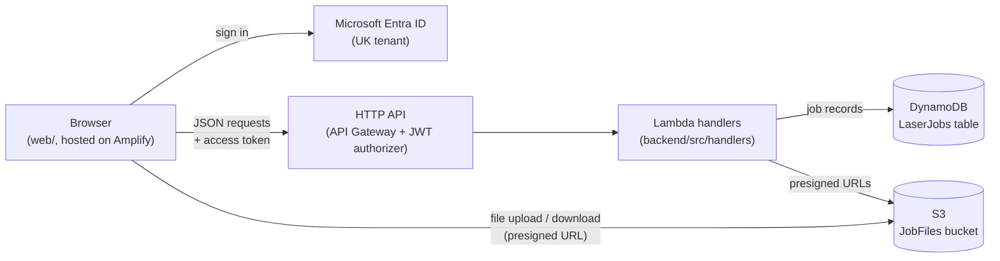
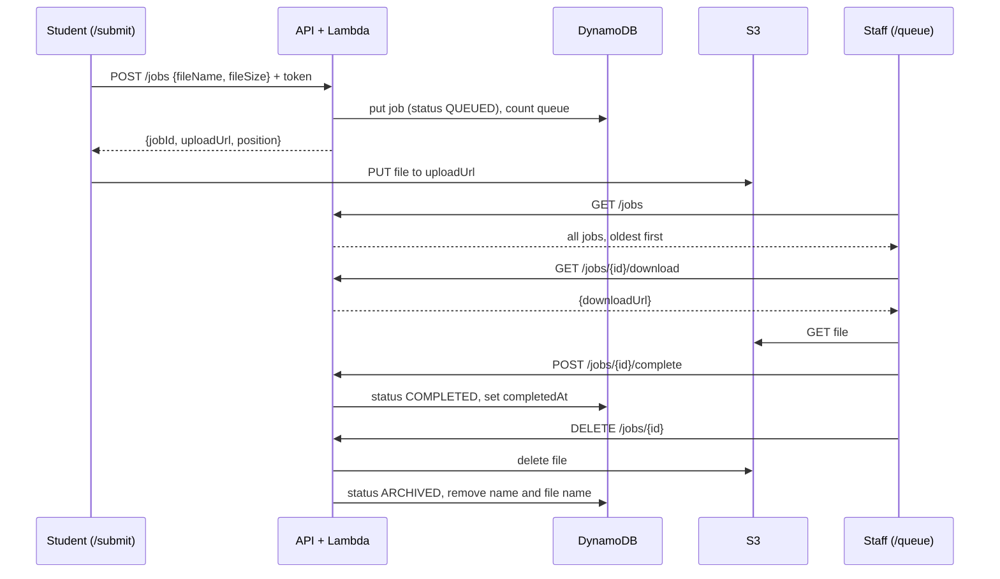
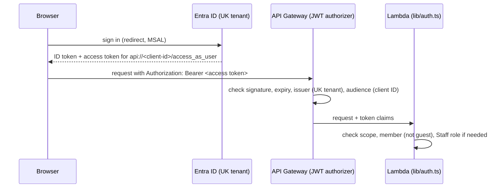
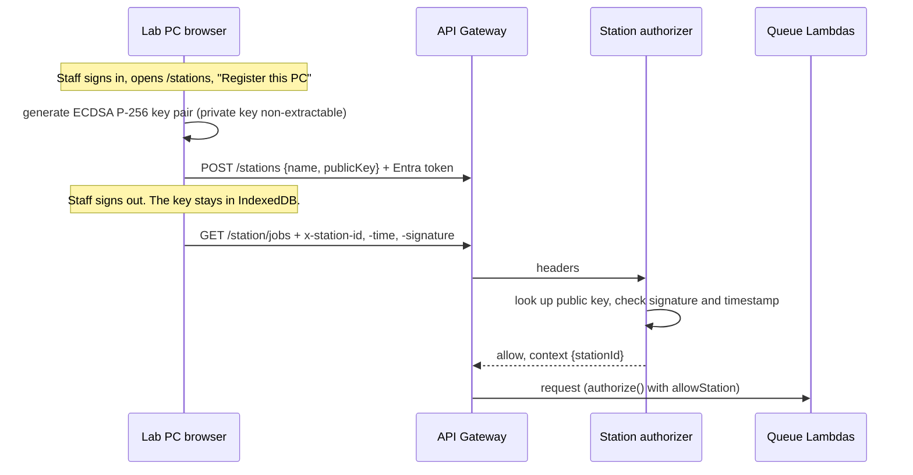

# Architecture

How the pieces fit together, and why they are built this way. For setup and
commands, see the [README](../README.md). For how to make changes, see
[CONTRIBUTING](../CONTRIBUTING.md).

## Overview

There are four pages:

- **`/submit`** (`web/src/pages/SubmitPage.tsx`): signed-in students upload an
  `.ai` file. Their name comes from their UK account. The page shows how
  many jobs are in line and, after submitting, the student's place in line.
- **`/queue`** (`web/src/pages/QueuePage.tsx`): staff on the lab PC see every
  job, download files, mark jobs completed, and delete completed jobs.
- **`/analytics`** (`web/src/pages/AnalyticsPage.tsx`): staff see how much the
  laser gets used: totals, records, a calendar heat map and talking points.
- **`/stations`** (`web/src/pages/StationsPage.tsx`): staff register the lab PC
  as a lab station and remove stations (see [Lab stations](#lab-stations)).

All pages are behind sign-in (`web/src/components/AuthGate.tsx`), except that
a registered lab station with nobody signed in gets `/queue`. Staff get links
to all four in the top bar (`StaffNav.tsx`); students only have `/submit`, so
they get no links.

All AWS resources are defined in one CDK stack,
`infra/lib/laser-queue-stack.ts`. It is deployed twice, as `LaserQueue-dev` and
`LaserQueue-prod`.

## Job lifecycle

A job is `QUEUED`, then `COMPLETED`, then `ARCHIVED` once staff delete it.
Only completed jobs can be deleted. Deleting removes the file, the student's
name and the file name, but keeps the record's timestamps so analytics can
still count the job. Archived jobs never appear in `GET /jobs` and can't be
downloaded or completed again.

## Weekly cleanup

`backend/src/scheduled/cleanup.ts` runs every Sunday at 3 AM Eastern
(EventBridge Scheduler, `WeeklyCleanupSchedule` in the stack). It archives
jobs exactly as the delete button does (`archiveJob()` in `lib/jobs.ts`):

- every `COMPLETED` job staff didn't delete, and
- every `QUEUED` job older than `QUEUED_JOB_MAX_AGE_DAYS` (14). These are
  treated as abandoned: the student left, or the upload never finished. They
  are archived without a `completedAt`, so analytics counts them as expired,
  not cut.

It isn't an API route, so it doesn't call `authorize()`: only the scheduler
can invoke it. If any job fails, the run fails and the scheduler retries it
(up to twice); archived jobs are skipped, so a retry only picks up what's
left. Its logs are in CloudWatch under the `WeeklyCleanup` function.

As a backstop, an S3 lifecycle rule deletes any file under `jobs/` older than
`FILE_MAX_AGE_DAYS` (30). No job can legitimately keep its file that long (14
days queued plus up to a week until the next cleanup), so the rule only
catches files the cleanup missed.

## Authentication

Users sign in with Microsoft Entra ID using the app registration **Innovation
Center Queue** in the University of Kentucky tenant. There is no Cognito and
no client secret: the browser gets tokens straight from Entra, and API Gateway
checks them.

Checks happen in two layers:

1. **API Gateway** (`HttpJwtAuthorizer` in `infra/lib/laser-queue-stack.ts`)
   is the default authorizer for every route. It rejects requests without a
   valid token from the UK tenant issued for this app with **401**, before any
   Lambda runs.
2. **The handler** calls `authorize()` from `backend/src/lib/auth.ts` first. It
   requires the `access_as_user` scope and `acct = 0` (a tenant member, not an
   invited guest). For staff routes it also requires the `Staff` app role.
   Failures return **403**.

The frontend (`web/src/auth.ts`) uses `@azure/msal-browser` with redirect
sign-in. MSAL clears its own token cache when the browser closes.

Nobody stays signed in: MSAL keeps tokens in `sessionStorage`, so they go
when the tab closes. The lab PC uses a [lab station](#lab-stations) instead.
`request()` in `web/src/api.ts` attaches a fresh access token to every call.
The queue page hides itself from non-staff, but that's only for a friendlier
message: the API enforces the role either way.

`createJob` takes the student's name from the token, not from the request
body, so nobody can submit a job under someone else's name. The name is the
only personal detail stored with a job. `authorize()` still reads the linkblue
`preferred_username` and Entra object ID to check the caller, but they are not
saved. The frontend shows the student their own email from MSAL so they know
which account they're on.

Entra settings this depends on (app registration unless noted):

- **Authentication:** Single-page application redirect URIs for every frontend
  origin (the Amplify URL and `http://localhost:5173`).
- **Expose an API:** scope `access_as_user`.
- **Manifest:** `requestedAccessTokenVersion: 2`. With v1 tokens the issuer
  doesn't match and every request gets 401.
- **App roles:** `Staff`, assigned to people under Enterprise applications.
- **Token configuration:** optional claims `acct` and `email` on the access
  token. Without `acct`, every request is rejected (it fails closed).

## Lab stations

The lab PC needs the queue open all day, but leaving a staff member's UK
account signed in on it would also leave their email, OneDrive and every
other UK site open to whoever sits down. So the PC is registered as a **lab
station** instead: it holds a key that only works for this queue, and nobody
is signed in.

- **The key can't be copied off the PC.** The browser creates the private key
  with `extractable: false` and stores the `CryptoKey` object in IndexedDB
  (`web/src/station.ts`). Scripts, including devtools, can ask the browser to
  sign with it but can't read it. Only the public key is sent to the API.
- **Every request is signed.** The signature covers the method, path, a
  timestamp and the station ID (`signedMessage()` in
  `backend/src/lib/stations.ts`, mirrored in `web/src/station.ts`). The
  authorizer rejects timestamps more than 5 minutes off, so the PC's clock
  must be right.
- **Stations can only use the queue.** They call the same Lambdas as staff,
  under `/station/*` routes that use the station authorizer
  (`backend/src/authorizers/station.ts`) instead of the Entra one. Handlers
  only accept a station if they pass `allowStation` to `authorize()`, which
  only the four queue handlers do. A station can't submit jobs, see
  analytics, or manage stations.
- **Removing a station works immediately.** The authorizer doesn't cache its
  results, so the station's next request fails.
- **Staff see when each station was last used and from which IP**, so a key
  used from somewhere unexpected stands out. The authorizer updates this at
  most every 5 minutes.
- **Stations are kept in their own table** (`LabStations`), so nothing that
  scans jobs sees them. At most `MAX_STATIONS` (20) can be registered.

On a station, the top bar shows the station's name and a **Staff sign in**
button, which always asks for a password (`prompt=login`) in case Microsoft
still remembers the last person. While someone is signed in on a station PC, a
banner reminds them to sign out. After they do, the PC goes back to being the
station.

The browser may clear IndexedDB if the disk fills up (`saveStation()` asks it
not to). Clearing site data for the app also deletes the key. Either way, a
staff member registers the PC again and removes the old entry.

## Data model

The job record is defined in [`backend/src/types.ts`](../backend/src/types.ts).
That file is the source of truth for its fields.

- **DynamoDB**: `LaserJobs`, partition key `jobId` (a UUID), no secondary
  indexes. Lab stations are in a separate `LabStations` table, partition key
  `stationId` (`Station` in `types.ts`).
- **S3**: one private bucket. Each file is stored at
  `jobs/{jobId}/{sanitized file name}`.
- **API responses** use `JobSummary`, which is the job without `s3Key`. Bucket
  paths never leave the backend.
- **Archived jobs** (`ArchivedJob`) share the table. Anything that scans it
  must decide whether to skip them, as `GET /jobs` does. An archived job with
  no `completedAt` expired in the queue without being cut.

`web/src/api.ts` keeps its own copy of these types, because the frontend
doesn't import from `backend/`. If you change one, change the other.

## Design decisions

**Files never pass through Lambda.** Lambda and API Gateway have small payload
limits, and streaming large files through them costs money for no benefit. The
API hands out presigned S3 URLs that expire after a few minutes
(`URL_EXPIRY_SECONDS` in the stack), and the browser talks to S3 directly.

**The file-size limit is enforced by S3, not by the frontend.** `createJob`
signs the upload URL with the exact `Content-Length` the client declared, so S3
rejects an upload of any other size. The frontend also checks the size, but
only to show a friendlier error.

**The job record is written before the file is uploaded.** If a student closes
the tab mid-upload, a `QUEUED` job with no file is left behind. `getDownloadUrl`
checks for the file first and returns a clear 404 when it's missing.

**Delete removes the file first, then archives the record.** If the S3 delete
fails, the record is still there and staff can retry. Doing it the other way
round could leave files in S3 that nothing points to.

**Deleted jobs are archived, not removed.** Analytics needs every job ever cut,
and staff delete completed jobs to tidy the queue. Archiving keeps only the
timestamps, so nothing personal outlives the delete.

**Analytics are counted on the server, in the lab's time zone.**
`GET /analytics` (`backend/src/lib/analytics.ts`) rolls jobs up into counts
per day in `America/New_York`, so a job cut at 10 PM lands on the right day
whatever time zone the viewer is in, and the response stays small as history
grows. The page (`web/src/analytics.ts`) works out weeks, months and records
from those daily counts. A "cut" is a job marked completed, counted on the day
it was completed.

**`GET /jobs` scans the whole table**, and so do `GET /queue/length`,
`GET /analytics`, the weekly cleanup and `createJob` (to count the queue). That's fine at lab scale (hundreds of
jobs). If the table ever grows large, add a secondary index on `status` or
`createdAt` and query that instead.

**Authorization is checked in two places on purpose.** The JWT authorizer
can't check app roles (only scopes), so the role check lives in the handlers.
Making the authorizer the API's default means a new route can't be added
without sign-in by accident.

**Each Lambda gets only the permissions it needs.** See the `grant*` calls in
the stack: for example, `listJobs` can only read the table.

**Configuration comes from environment variables.** The stack sets
`TABLE_NAME`, `BUCKET_NAME`, `MAX_FILE_SIZE_BYTES` and `URL_EXPIRY_SECONDS` on
every Lambda, and `backend/src/lib/config.ts` reads them. Nothing in
`backend/` hard-codes resource names.

**Local development uses the real dev stack.** There's no local AWS emulator.
`npm run dev` runs the frontend against the deployed `LaserQueue-dev` API, and
`npm run reset:dev` empties it. The reset script refuses to touch any stack
other than dev.

**Prod is protected against accidental deletion.** The prod stack has
termination protection, and its table has deletion protection and
point-in-time recovery. Dev has neither, so it can be torn down freely.

## Known limitations

- **Any UK member can submit, not only students.** Faculty and staff accounts
  can sign in too. Restricting to students would need a student group from UK
  IT ("Assignment required" on the enterprise app).
- **New staff must sign out and back in** before `/queue` works, because the
  role is read from their token.
- **No automated tests for the app itself.** CI type-checks every workspace,
  builds the frontend and synthesizes the CDK stack. Only `scripts/deploy.mjs`
  has tests.
- **Analytics only go back to this feature's release.** Before it, deleting a
  job removed its record, so jobs deleted earlier aren't counted. Jobs that
  were still in the table then are.
- **The queue page doesn't update on its own.** Staff press Refresh to see new
  submissions.
